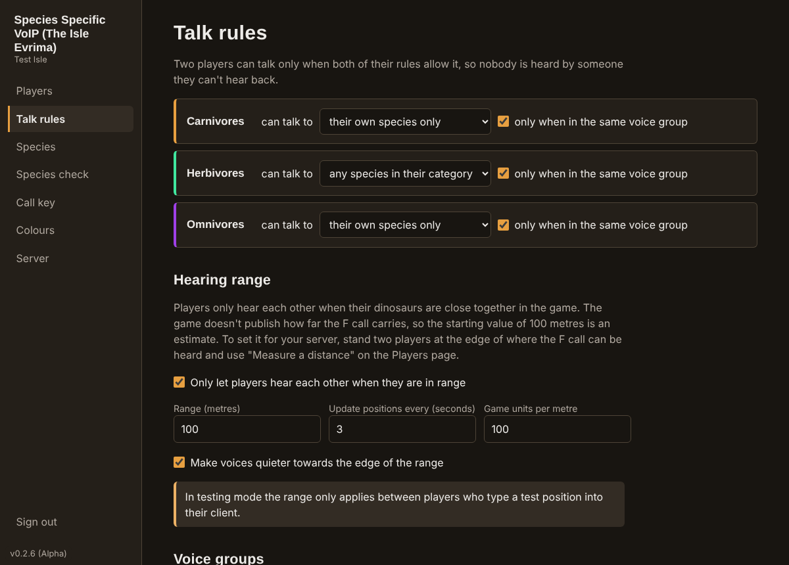

# Species Specific VoIP (The Isle Evrima)

Species-specific, proximity-based voice chat for [The Isle](https://store.steampowered.com/app/376210/The_Isle/) Evrima community servers. Players only hear their own kind, in their group, when they are close together in the game. Server owners set the rules in a browser admin panel.

**Status: v0.3.0 (Beta).** Source code only, no installers. The author runs it on Windows 11 with a live Isle Evrima server, server and client, and it works there. Linux has only been tested without the game, and macOS not at all, so expect rough edges. Feedback is encouraged: please open an issue.

## Try the demo

See the server setup, the admin panel and the player client before installing anything. The demo uses made-up players and a pretend server, and nothing in it is saved or sent anywhere.

- Online: <https://escaped-raptor.github.io/isle-voip/demo/Species-Specific-VoIP-Demo.html>
- Or download this repository and open `demo/Species-Specific-VoIP-Demo.html` in a browser.

## Quick start

No command-line knowledge needed on Windows.

- **Windows:** download this repository (**Code → Download ZIP**), extract it, open the **`Windows-Installers`** folder and double-click **`setup.bat`**. It installs what's needed and asks whether you want the client, the server or both. Then double-click `start-client.bat` or `start-server.bat` in the same folder. Setup has been tested on Windows and works.
- **Linux:** run `bash Linux-Installers/setup.sh`, then `bash Linux-Installers/start-client.sh` or `bash Linux-Installers/start-server.sh`.

## Guides

| Guide | For |
|---|---|
| [Overview](Readme-overview.md) | What it does, how it works, and what is and isn't tested yet |
| [Server guide](server/Readme-server.md) | Whoever runs the Isle Evrima server |
| [Client guide](client/Readme-client.md) | Players |

## Licence

[MIT](LICENSE). This is a community project and is not affiliated with or endorsed by Afterthought LLC.
