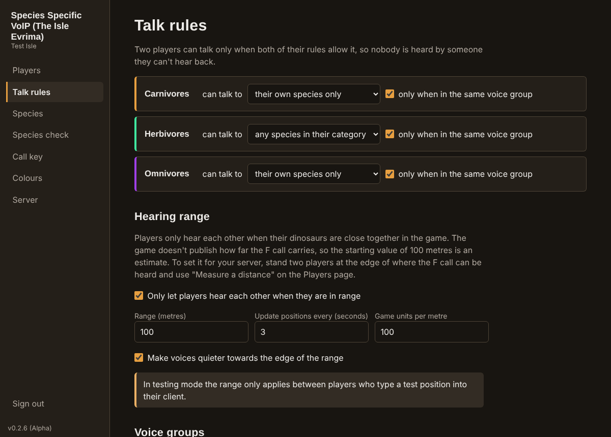

# Species Specific VoIP (The Isle Evrima)

Species-aware voice chat for [The Isle](https://store.steampowered.com/app/376210/The_Isle/) community servers.

Players only hear the dinosaurs the server's rules say they should, and only when those dinosaurs are nearby in the game: by default, carnivores and omnivores talk to their own species inside a group, herbivores talk to other herbivores inside a group, and everyone has to be within hearing range. Server owners change the rules, add species and pick their colours in a browser-based admin panel that is completely separate from the game.

This is a community project. It is not affiliated with or endorsed by Afterthought LLC.



## Try the demo first

Open **`demo/Species-Specific-VoIP-Demo.html`** in any web browser (double-click it). It is one self-contained file that lets you click through the server's first-run setup, the admin panel and the player client, using made-up players and a pretend server. It needs no install, no server, no microphone and no internet connection, and nothing you do in it is saved or sent anywhere.

You can also open it online without downloading anything: <https://escaped-raptor.github.io/isle-voip/demo/Species-Specific-VoIP-Demo.html>

The demo is built from the same screens the real apps use, so what you see is what you get. Audio, Steam sign-in, certificates and the in-game call key are simulated, and the demo says so where it matters.

## Two parts, two guides

| Part | Who it's for | Easiest way to install | Guide |
|---|---|---|---|
| **Server** (`server/`, `server-app/`) | Whoever runs the Isle Evrima server. Includes the admin panel. | Run `setup.bat` in `Windows-Installers` (Windows) or `bash Linux-Installers/setup.sh` (Linux), then answer the first-run questions on the setup page. | [Server guide](server/Readme-server.md) |
| **Client** (`client/`) | Players. The desktop app with push to talk and the call key. | Run `setup.bat` in `Windows-Installers` (Windows) or `bash Linux-Installers/setup.sh` (Linux). | [Client guide](client/Readme-client.md) |

**Setup is one file.** On Windows, double-click `setup.bat` in the `Windows-Installers` folder; on Linux, run `bash Linux-Installers/setup.sh`. It checks for Node.js, offers to install it, and downloads what the client or server needs. No installers are published; the project is distributed as source code, and the guides also explain how to build an installer yourself if you want one.

Both parts always carry the same version number, shown in the bottom-left corner of their screens. Keep the server and the clients on the same version. The current release is **v0.3.0 (Beta)**.

Both guides have instructions for Windows, Linux and macOS.

Source: <https://github.com/escaped-raptor/isle-voip>

## What it does

| Feature | Detail |
|---|---|
| Species rules | Carnivores and omnivores: same species, same group. Herbivores: any herbivore, same group. All of it can be changed per category and per species. |
| Proximity | Voice only carries between players whose dinosaurs are within range of each other in the game (100 m by default, adjustable). Voices get quieter towards the edge of the range. |
| Species check | Every player's species is verified against the game server when they join voice, then re-checked on a timer (20 s by default), so a death or respawn can't leave someone in the wrong channel. |
| Custom species | Add, rename, re-categorise or remove species under Carnivore, Herbivore and Omnivore, each with its own optional rule. |
| Admin panel | A web page served by the voice server. No game client or mod needed. |
| Colour themes | A colour wheel with a draggable handle and harmonies of 2, 3, 4 or 5 colours, in both the admin panel and the player client. |
| Call key | When a player starts talking (push to talk or voice activated), the client can press the game's call key, F by default, like the game's own voice chat. It is **off by default**: each player turns it on for themselves. Server owners can disallow it for everyone, and players can rebind it. |
| Secure by default | Connections use HTTPS. Bring a certificate from any publicly trusted provider (self-signed ones are refused), or let the server get a free one automatically. The server guide lists free and paid providers. |
| One-file setup | `setup.bat` in `Windows-Installers` and `setup.sh` in `Linux-Installers` install what's needed and let you choose client, server or both. `start-client` and `start-server` files then launch them. |
| Push to talk on any key | Hold a key or mouse button to talk. The default is **F**, the game's own call key, so talking makes your dinosaur call the way the game's built-in voice chat does. Change it in the client's Settings. Voice activation is the alternative. |
| Installers you build yourself | The project can package the client and the server app as Windows, Linux and macOS installers. None are published; you build them from the source if you want them. |
| Server app with first-run setup | The server runs as a desktop app with a tray icon. The first time, it asks a few questions in a window (address, port, certificate, admin password) instead of making you edit a config file. |
| Finds the server by itself | The client assumes the voice service is on the same port number as the game (7777), remembers the server, and reconnects when it starts. Address and port can be changed in its Settings. |
| Quiet when there is no voice service | If the server isn't running this service the client stays silent, checks again a few times at growing intervals, then stops. It never floods a server or interrupts the game. |
| Privacy | All audio is relayed through the server and encrypted. Players never connect to each other, so nobody can see anybody else's IP address. |

## How it works

```
 Player client ──HTTPS/WSS (sign-in, signalling)──┐
      │                                           ▼
      └──────── encrypted audio (DTLS-SRTP) ──► Voice server ──RCON──► The Isle server
                                                  ▲   │                (which species is
 Player client ───────────────────────────────────┘   │                 each player?)
                                                      ▼
                                              Admin panel (browser)
```

- **Server** (`server/`): Node.js. Uses [mediasoup](https://mediasoup.org/) as a WebRTC relay (an SFU). It decides who hears whom and only forwards audio between players the rules allow. A modified client can't listen in, because the audio it isn't allowed to hear is never sent to it.
- **Client** (`client/`): an Electron desktop app. It adds the parts a web page can't do: push to talk that works while the game has focus, and pressing the call key. The same interface can also be served by the voice server as a web page at `/play/` for players who don't want to install anything (no global push to talk or call key there).
- **Shared** (`shared/`): the colour wheel and theme used by both.

Players sign in with Steam (OpenID), which proves their SteamID64 to the voice server without it ever seeing a password. The server then asks the game server which dinosaur that SteamID is playing.

## Things to know before you rely on it

These are real limits, not fine print.

1. **The default hearing range is an estimate.** The game does not publish how far the F call carries, and it may differ by species, so the range starts at 100 metres. Measure it on your own server (see [Setting the hearing range](server/Readme-server.md#setting-the-hearing-range)) and change it under **Talk rules**.
2. **Proximity is only as fresh as RCON.** Positions come from the game server over RCON every 3 seconds by default, so a player crossing the edge of the range is connected or cut a few seconds late. Proximity needs the RCON species check: Legacy save files only hold the position from the last save, so the range is not applied with them.
3. **Groups are voice groups, not the game's groups.** The Isle does not expose its in-game groups to outside tools (Evrima's RCON reports class, growth, location and so on, but no group). So players make a *voice group* in the client: one player presses **Start a group** and shares a 6-character code. The server only lets compatible species share a voice group, and removes a player from it the moment their species stops fitting.
4. **The RCON reply format is undocumented.** The parser looks for a 17-digit ID, a `Class:` field and a `Location: X=… Y=… Z=…` field in each player record and ignores the rest. Positions are assumed to be in Unreal units of 1 cm (100 per metre, changeable). It is tested against sample replies, not yet against a live Evrima server. Use **Species check → Test connection** in the admin panel: it shows the raw reply and what the parser understood. If your server's build replies differently, please open an issue with that output.
5. **The call key press is synthetic input, and is off by default.** When a player turns it on, the client sends an ordinary key press to the operating system, the way keyboard macro software does. It does not read or modify the game. It has not been tested in-game, and whether the game's anti-cheat accepts synthetic key presses is not something this project can promise, which is why each player has to switch it on themselves. Server owners can also disallow it for everyone.
6. **Steam sign-in and Legacy saves are untested against the real thing.** The Steam OpenID check is covered by tests with a stand-in for Steam, and the Legacy save reader expects a `CharacterClass` field in each `<SteamID64>.json`. Neither has been run against live Steam or a live Legacy server yet.
7. **Platforms tested.** This is a beta in name: the features are complete, but real-world testing is still thin. The server, the admin panel, the first-run setup, the server app, the web client and the desktop client have been tested end to end on Linux, including real audio between browsers. Installers built from v0.2.6 were run on Windows 11: both apps install and start, and the server's first-run setup and admin panel work there. Not yet tried on Windows: a client connecting to a server, push to talk while a game has focus, and the call key press. `setup.bat` has been tested on Windows and works; the `start` `.bat` files have only been checked under Wine, a Windows compatibility layer. The Linux `setup.sh` and `start` files have been run for real. Nothing has been run on macOS. Linux and macOS installers have never been built or run.
8. **Automatic HTTPS is untested against the live service.** The server can get and renew a free Let's Encrypt certificate by itself. Everything around that has been tested (checking certificates, renewal timing, error messages), but the exchange with Let's Encrypt itself has not been run yet. Bringing your own certificate from a trusted provider is the tested route.
9. **The default species list** covers 17 Evrima playables. If the game reports a class that isn't in your list, the admin panel's Players page shows it with one-click buttons to add it.

## Security and privacy

- **No peer-to-peer connections.** Every client sends audio to the server and receives audio from the server. The only address a client is ever given is the server's own. Other players' IP addresses are never sent to anyone, shown in the admin panel, or written to logs.
- **Encrypted in transit.** Sign-in and signalling use TLS. Audio uses DTLS-SRTP, as all WebRTC does. Audio is decrypted on the server in order to be forwarded; it is not end-to-end encrypted and is never recorded.
- **Rules are enforced on the server.** A client only receives streams the rules allow, and only learns the names of players it can talk to. SteamIDs of other players are never sent to clients.
- **Trusted certificates only.** The server refuses self-signed certificates and any certificate not issued by a publicly trusted authority. With no certificate it obtains one from Let's Encrypt.
- **Identity.** Steam OpenID proves each player's SteamID64. Session tokens are signed with a key generated on first run and last 30 days, so a client can reconnect by itself after a restart.
- **No spam in either direction.** A client checks that the voice service is really there before it connects, and backs off and then stops if it isn't. The server refuses clients that aren't this project's client or are on a different protocol, and limits how often any one address can connect.
- **Fails closed.** If the game server can't be reached, players whose species hasn't been verified stay silent.

Each guide covers its own side: [server security](server/Readme-server.md#security) and [client privacy](client/Readme-client.md#privacy).

If you find a security problem, please open a private security advisory on GitHub rather than a public issue.

## Development

```bash
cd server
npm test
```

The tests start the real server and media relay and drive them with scripted clients. They cover the rules engine, settings validation, RCON parsing (against a fake RCON server), proximity, the service and protocol checks, connection limits, group handling, live rule changes, and checks that no SteamIDs or IP addresses leak to other players.

To try everything on one machine, choose **Testing without a certificate** on the setup page, or by hand set `"authMode": "dev"`, leave `tls` empty and use `"port": 8443`, `"publicUrl": "http://localhost:8443"` and `"announcedAddress": "127.0.0.1"`. Build the client, open `http://localhost:8443/play/` in two browser windows and give each a different 17-digit SteamID from the testing whitelist (testing mode only admits whitelisted SteamIDs, up to 30 players). In this test mode each client picks its own species and can type a test position in metres to try proximity.

Layout:

```
server/Readme-server.md              server guide
client/Readme-client.md              client guide
server/src/policy.js          who may talk to whom (pure functions)
server/src/hub.js             players, species checks, groups, audio routing
server/src/rcon.js            Evrima RCON client and reply parser
server/src/species-source.js  RCON / Legacy saves / manual
server/src/auth.js            Steam OpenID, tokens, admin password
server/src/sfu.js             mediasoup relay
server/src/server.js          HTTP API, static pages, signalling
server/src/certs.js           certificate checks and automatic HTTPS
server/src/setup.js           first-run setup page
server/src/launch.js          starts setup or the server
server-app/                   the server as a desktop app (window, tray, installer)
demo/                         the click-through demo file and the script that builds it
Windows-Installers/           setup.bat, setup-client.bat, setup-server.bat, start-client.bat, start-server.bat
Linux-Installers/             setup.sh, start-client.sh, start-server.sh
server/public/admin/          admin panel
shared/theme.js               colour wheel and harmonies
client/main.js                desktop shell: global keys, call key, Steam window, saved sign-in
client/build/                 installer settings and the app icon
client/src/renderer.js        client interface and WebRTC
scripts/bump-version.mjs      moves to the next version number
```

### Rebuilding the demo

The demo file is generated from the real GUI files. After changing the admin panel, the setup page or the client, rebuild it from the repository root:

```bash
node demo/build-demo.mjs
```

This needs the client's build tools (`npm install` in `client/`, once).

### Version numbers

Every release moves to the next number with one command, run from the repository root (the same on Windows, Linux and macOS):

```bash
node scripts/bump-version.mjs
```

The last digit counts from 0 to 9, then the middle number goes up and the last digit starts again: v0.2.3, v0.2.4 … v0.2.9, v0.3.0, v0.3.1 and so on. The script updates the server, the server app and the client together, and both GUIs show the number in their bottom-left corner.

The stage shown after the number, as in "v0.3.0 (Beta)", comes from the `releaseStage` field in `server/package.json` and `client/package.json`. Bumping the version keeps it. Change it, or delete the field, in both files when the project moves on.

Contributions are welcome, especially confirmed RCON reply samples from current Evrima builds and Windows test reports.

## Licence

[MIT](LICENSE)
