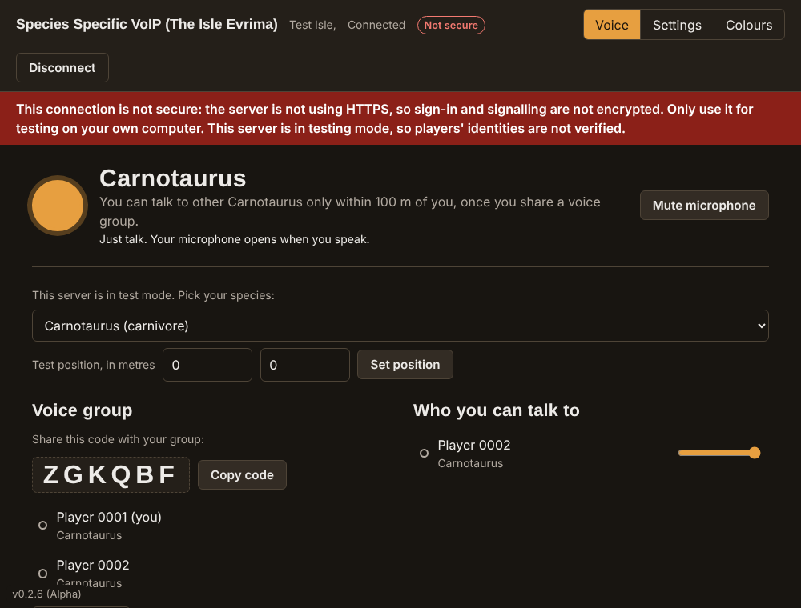

# Species Specific VoIP (The Isle Evrima): client guide

This is the client side: the desktop app players use to talk. It adds push to talk that works while the game has focus, and presses the in-game call key when you start talking.

You need the address of a voice server run by your Isle Evrima community. To run a server, see the [server guide](../server/Readme-server.md). For what the project does and its known limits, see the [project overview](../Readme-overview.md). To see the screens before installing anything, open the demo: `demo/Species-Specific-VoIP-Demo.html`.

## Contents

- [What you need](#what-you-need)
- [Which system?](#which-system)
- [Quick setup](#quick-setup)
- [Getting the client](#getting-the-client)
- [Connecting to a server](#connecting-to-a-server)
- [When there is no voice service](#when-there-is-no-voice-service)
- [Install from source](#install-from-source)
- [Build an installer](#build-an-installer)
- [Using it](#using-it)
- [Call key](#call-key)
- [Colours](#colours)
- [No install: the web client](#no-install-the-web-client)
- [Privacy](#privacy)
- [Troubleshooting](#troubleshooting)

## What you need

- **Windows, Linux or macOS.** The Steam store lists The Isle for Windows, so that is where most players will run the client. See [Which system?](#which-system) for what works where.
- A microphone.
- A Steam account, to sign in.
- [Node.js](https://nodejs.org/) 20 or newer, to run or build from source.



## Which system?

| | Windows | Linux | macOS |
|---|---|---|---|
| Voice, groups, colours | Yes | Yes | Yes |
| Push to talk while the game has focus | Yes | Yes, on X11 (not Wayland) | Yes, after granting permissions |
| Call key press | Yes | Yes, on X11 | Yes, after granting permissions |
| Tested for this project | Yes: set up with `setup.bat` and used on Windows 11 with a live Isle Evrima server | Yes, including `setup.sh`, but not with the game | Not yet |

The voice server only connects players it can see spawned in the game under the same Steam account. So on a system the game doesn't run on, the client only works while the game is running on that account somewhere else, for example streamed from a Windows PC.

## Quick setup

The easiest way to get the client onto a computer.

**Windows**

1. Download the project: on the GitHub page press **Code → Download ZIP**, then right-click the zip and choose **Extract All**.
2. Open the extracted folder, open the **`Windows-Installers`** folder inside it, and double-click **`setup.bat`**.
3. If Node.js isn't installed, it offers to install it for you. Type `Y` and press Enter.
4. Choose **1** for the client.
5. Wait while it downloads what it needs (a few minutes, about 300 MB each).
6. Double-click **`start-client.bat`**, in the same `Windows-Installers` folder, whenever you want to run it.

`setup-client.bat` does the same without asking which part you want.

**Linux** (and macOS)

```bash
bash Linux-Installers/setup.sh
```

It does the same job: checks for Node.js, offers the command to install it if it's missing, then asks whether to set up the client, the server or both.

Then start it with `bash Linux-Installers/start-client.sh`. Global push to talk needs an X11 session; see [Which system?](#which-system)

Setup is safe to run more than once, and it installs nothing outside the project folder except Node.js itself. It hides npm's harmless "deprecated" notices about build tools, so anything it does print is worth reading.

## Getting the client

**No ready-made installer is published.** The client is distributed as source code. [Quick setup](#quick-setup) above is the easy way to run it. You can also install it by hand (see [Install from source](#install-from-source)) or build an installer for yourself and your players (see [Build an installer](#build-an-installer)).

An installer built from this project contains the app, its runtime and every library it uses; asks only where to install; needs no administrator rights; and adds desktop and Start menu shortcuts. It is not code-signed, so Windows SmartScreen warns the first time: choose **More info → Run anyway**. Only run an installer from someone you trust, such as your server's admins.

## Connecting to a server

The first time, type your server's **voice address** and press **Sign in with Steam**.

- **Port.** Leave it empty if your server runs voice on the same port number as the game (7777), which is what the client assumes. If your server's admins gave you a different port number, type it in the Port box.
- **Stay signed in on this computer** is ticked by default. With it, the client remembers the server and your sign-in, and connects by itself every time it starts. Untick it to sign in each time.

Trying it with a server on the same PC in testing mode? Type `http://localhost` as the address and sign in with a SteamID from that server's whitelist. The client will show "Not secure", which is expected there.

To use a different server or port later, open **Settings → Voice server**, change the address or port and press **Connect to this server**. The client remembers your last five servers and your sign-in for each, so going back to your usual one doesn't ask you to sign in again.

## When there is no voice service

The client never assumes a server has voice. Before connecting it asks the address one small question and only goes ahead if this voice service answers.

If the service isn't there (the server doesn't run it, it is switched off, or the port is wrong), the client stays quiet:

- Nothing pops up, flashes or takes focus from your game.
- Your microphone stays closed and the call key is never pressed.
- It checks again after about 10 seconds, 30 seconds, 1 minute, 2 minutes, 5 minutes, then three times 10 minutes apart. Each check is a single tiny request.
- After those eight checks it **stops**, so a server that doesn't run voice isn't bothered. Press **Check for voice service** when you want it to look again.

The same thing happens if the voice server goes away while you are connected: the client goes quiet, checks on that schedule, and reconnects by itself when the server is back. **Stop checking** ends it at any time.

If the server runs a different version that the client can't talk to, it tells you once to update and does not keep trying.

## Install from source

**Windows** (PowerShell)

```powershell
winget install OpenJS.NodeJS.LTS
winget install Git.Git
# close and reopen PowerShell, then:
git clone https://github.com/escaped-raptor/isle-voip.git
cd isle-voip\client
npm install
npm start
```

No Git? Download the ZIP from the GitHub page (**Code → Download ZIP**), extract it, and run the last two commands in its `client` folder.

**Linux** (Debian or Ubuntu shown)

```bash
curl -fsSL https://deb.nodesource.com/setup_22.x | sudo -E bash -
sudo apt install -y nodejs git
git clone https://github.com/escaped-raptor/isle-voip.git
cd isle-voip/client
npm install
npm start
```

Global push to talk and the call key need an X11 session. Under Wayland, log in with the "Xorg" or "X11" session, or use voice activation.

**macOS** (with [Homebrew](https://brew.sh/))

```bash
brew install node git
git clone https://github.com/escaped-raptor/isle-voip.git
cd isle-voip/client
npm install
npm start
```

The first time, macOS asks for permissions. Allow all three under **System Settings → Privacy & Security**, then restart the app:

- **Microphone**: to talk.
- **Input Monitoring**: so push to talk works while another window has focus.
- **Accessibility**: so the app can press the call key.

When running from source, macOS lists the permissions under the program you launched it from (Terminal, or Electron).

## Build an installer

Run this in the `client` folder on the system you are building for:

```bash
npm install
npm run dist
```

Results are written to `client/release/`.

| System | You get | First launch |
|---|---|---|
| Windows | `Species-Specific-VoIP-Setup-<version>.exe` | The app is not code-signed, so SmartScreen may warn: choose **More info → Run anyway**. |
| Linux | An `.AppImage` | `chmod +x` the file, then run it. |
| macOS | A `.dmg` | The app is not signed or notarised, so macOS blocks the first launch: open **System Settings → Privacy & Security** and choose **Open Anyway**, then grant the three permissions above. |

Windows installers built from v0.2.6 were run on Windows 11 and installed and started correctly. Linux and macOS installers have never been built or run.

## Using it

1. Enter your server's voice address and press **Sign in with Steam** (see [Connecting to a server](#connecting-to-a-server)). Steam's own page opens; the app never sees your Steam password.
2. Spawn in the game. Your species appears within a few seconds.
3. Group up in the game, then one player presses **Start a group** and shares the code. The others type it under **Join group**.
4. Stay close. You only hear group members who are within the server's hearing range, and they get quieter as they move away.
5. Talk. Hold **F** to talk: that is the default push-to-talk key, and because F is also the game's call key, your dinosaur calls as you speak. The game only has text chat, and your dinosaur calls when you write in it; this does the same for voice. This keeps things fair: voice chat apps outside the game let players talk without making a sound in the game, which is an unfair stealth advantage. To use a different key or mouse button (mouse 3 to 5), open **Settings**, click the key button and press the one you want. Or choose voice activated, with an adjustable level.

## Call key

When you start talking, the app can press your in-game call key so your dinosaur calls, the way it does when you type in the game's text chat.

**You may not need it.** With push to talk on its default key, F, you are already pressing the game's call key yourself each time you talk, so the call happens naturally and the app sends nothing to the game. The call key press below is for voice activation, or for when you have moved push to talk to another key.

**It is off by default.** Turning it on makes the app send a key press into your game, the way keyboard macro software does. It does not read or change the game, but it has not been tested with The Isle's anti-cheat, so whether to use it is your decision and your risk.

Under **Settings → Call key**:

- **Press my call key when I start talking** turns it on or off for you.
- **Call key** is F by default. If you rebound the call in the game, click the button and press your key so they match.
- A minimum gap between calls (3 seconds by default) stops rapid speech from spamming calls.

If the server owner has disallowed the call key, these controls are disabled and say so. If your push-to-talk key and call key are the same key, the app doesn't press it a second time.

## Colours

Open **Colours** in the app. Drag the circle on the wheel to pick a base colour, then choose a harmony of 2, 3, 4 or 5 colours, a brightness, and a dark or light background. The choice is saved on your computer.

## No install: the web client

If the server owner has turned it on, you can open `https://your-server-address/play/` in a browser instead. It works the same way, with two limits a web page can't get around: push to talk only works while the page has focus, and there is no call key.

## Privacy

- **Nobody sees your IP address.** Your audio goes to the voice server and nowhere else. You never connect to other players, and the server never tells anyone your address.
- **Encrypted.** Sign-in and audio are encrypted between you and the server. The server forwards audio and does not record it.
- **The app tells you if a connection is not secure.** While connected, the header shows **Secure** when the server is reached over HTTPS. If it is not, the header shows **Not secure** and a red banner stays on screen for as long as you are connected. A second line appears if the server is in testing mode, where players' identities are not verified. Real servers should always show Secure.
- **Steam sign-in.** You sign in on Steam's own page. The app and the voice server never see your Steam password; the server only learns your SteamID.
- **What other players see.** Only players you can talk to see your in-game name and species. Your SteamID is shown to the server's admins, not to other players.
- **Desktop client.** The page runs sandboxed with no Node.js access. No password is ever stored.
- **Stay signed in.** With this ticked, the voice server's sign-in token (not a password) is saved on your computer, encrypted by the operating system for your user account. It lasts 30 days. Untick it, or press **Sign out**, to remove it.
- **The call key.** Off unless you turn it on. When on, the app sends an ordinary key press to your computer, the way keyboard macro software does. It does not read or change the game. It has not been tested in-game, and whether the game's anti-cheat accepts synthetic key presses is not something this project can promise.

## Troubleshooting

| Problem | Check |
|---|---|
| "Can't reach that address" | Check the address with your server's admins. |
| "No voice service is running at that address" | The address answers, but not with this voice service. Usually the port is wrong: ask your server's admins for the voice port and enter it under **Settings → Voice server**. |
| The client stopped checking | It stops after eight checks so it doesn't bother the server. Press **Check for voice service**. |
| "Your SteamID is not on this server's testing whitelist" or "it is full" | The server is in testing mode, which only admits whitelisted players, up to 30. Ask its admins. The client does not keep retrying. |
| It says the server runs a different version | Install the client version that matches the server (shown bottom left in both). |
| "Not spawned yet" while playing | Your species is read from the game a few seconds after you spawn. If it stays, tell your server's admins. |
| In a group but nobody is "in range" | You only hear group members who are close to you in the game. |
| Nobody can hear you | Check the microphone under **Settings**, that you are not muted, and that the level bar moves when you speak. |
| The call key does nothing in game | It is off by default: turn it on under **Settings → Call key**. Then check the key matches your in-game binding. On Windows, if the game runs as administrator, run the client as administrator too. On macOS, check **Accessibility** is allowed. |
| Push to talk doesn't work on Linux | Global key capture needs X11. Under Wayland use voice activation, or log in with an X11 session. |
| Push to talk doesn't work on macOS | Allow **Input Monitoring** for the app under **System Settings → Privacy & Security**, then restart it. |
| macOS: no sound from your microphone | Allow **Microphone** for the app in the same place. |
