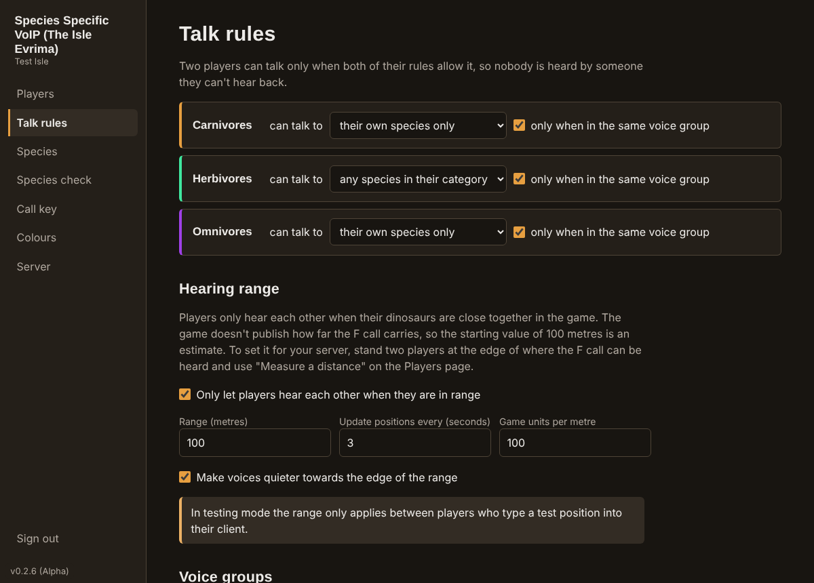
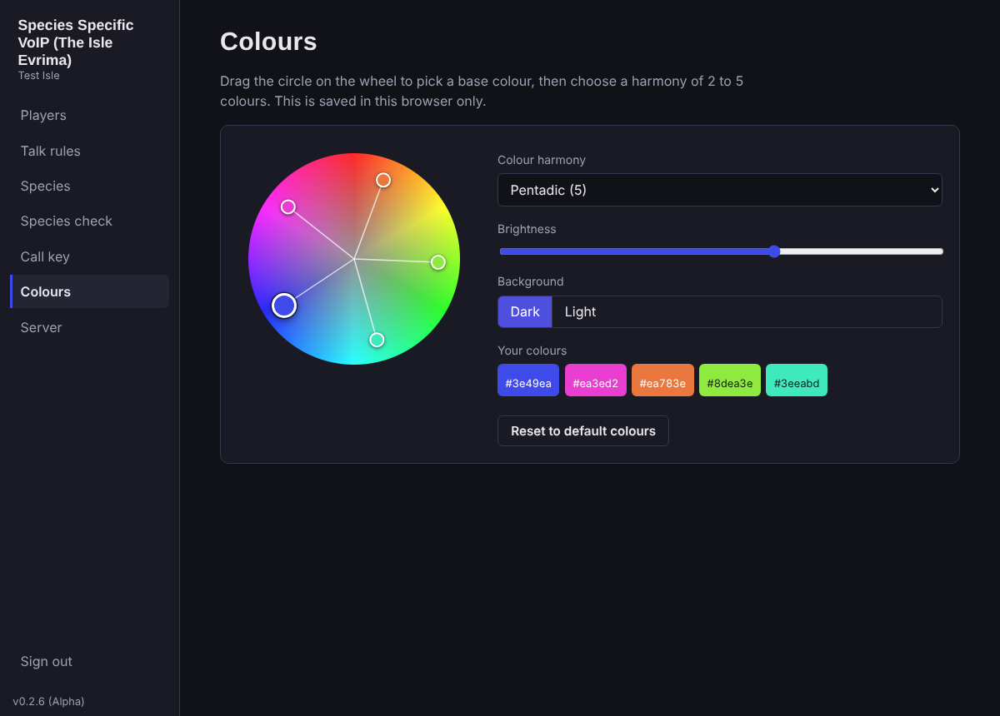

# Species Specific VoIP (The Isle Evrima): server guide

This is the server side: the voice server and its browser-based admin panel. It is for whoever runs the Isle Evrima game server.

For what the project does and its known limits, see the [project overview](../Readme-overview.md). To see the screens before installing anything, open the demo: `demo/Species-Specific-VoIP-Demo.html`. Players need the [client guide](../client/Readme-client.md) instead.



## Contents

- [The server app](#the-server-app)
- [First-run setup](#first-run-setup)
- [What you need](#what-you-need)
- [1. Install](#1-install)
- [Secure certificates and HTTPS](#secure-certificates-and-https)
- [2. Configure](#2-configure)
- [3. Open the firewall](#3-open-the-firewall)
- [4. Start](#4-start)
- [5. Connect it to your game server](#5-connect-it-to-your-game-server)
- [The admin panel](#the-admin-panel)
- [Connection checks and limits](#connection-checks-and-limits)
- [Updating](#updating)
- [Security](#security)
- [Troubleshooting](#troubleshooting)

## The server app

The server app runs the voice server as a normal desktop program with a window and a tray icon, and shows the [first-run setup](#first-run-setup) page the first time, so there is no config file to edit.

**No ready-made installer is published.** Run the app from source, or build an installer yourself:

```bash
cd server
npm install
cd ../server-app
npm install
npm start          # run the server app from source
npm run dist       # or build an installer into server-app/release/
```

These commands are the same on Windows (PowerShell), Linux and macOS, once Node.js is installed (see [1. Install](#1-install)). Build on the system you are building for. An installer you build is not code-signed, so Windows SmartScreen warns the first time it runs: choose **More info → Run anyway**.

**On Windows, the firewall asks twice** when the server starts for real players: once for the server app and once for "mediasoup-worker", which is the part of the server that relays the audio (its publisher shows as "Unknown"). Choose **Allow** for both, then open the same ports in your router or hosting control panel if you have one. In testing mode neither prompt appears, because the server only listens on that computer.

**Using the app**

- **It keeps running in the system tray.** Closing the window does not stop the voice server. Click the tray icon to open the admin panel again; choose **Quit** there to stop the server.
- **Start with the computer:** tick **Start when I sign in to this computer** in the tray menu (Windows and macOS).
- **Where your settings are:** in your user account's app-data folder, not in the app's own folder, so updating keeps them. **Open settings folder** in the tray menu shows it.
- **Run setup again:** in the tray menu. Your talk rules and species are kept, and you choose the admin password again.
- **Log:** **Open log** in the tray menu. It never contains players' IP addresses.

On a server with no desktop, skip the app and use the command-line steps further down.

## First-run setup

Whenever the server starts with no settings yet, it shows a setup page instead of the voice service. In the server app it opens in the app's window. With `npm start` it prints an address to open in a browser on the same computer.

| Question | What to enter |
|---|---|
| Name shown to players | Anything you like. |
| How the connection is secured | **I have a secure certificate**, **I don't have one: get a free certificate automatically (HTTPS)**, or **another program in front already provides HTTPS**. See [Secure certificates and HTTPS](#secure-certificates-and-https). |
| Voice address | The domain name players will type, for example `voice.example.com`. It must point at this server. |
| Voice port | Keep 7777 if that is your game port. See [Which port?](#which-port) |
| Public IP address | **Look it up** fills it in. |
| Certificate and private key files | Only if you have your own certificate. Use **Browse** in the server app, or type the paths. It must come from a publicly trusted provider; see [the list](#certificate-providers). |
| Email and agreement | Only for the automatic certificate: an optional contact email, and a tick to accept the Let's Encrypt Subscriber Agreement. |
| Admin password | For the admin panel. At least 10 characters. |

When you save, the page tells you which ports to open and what to give your players, and the voice server starts.

The setup page can only be opened from the server computer itself, and only with the one-time address the server shows. Nobody else on your network can configure your server.

**Testing without a certificate** is tucked under its own fold on the setup page. It works on that computer only, does not prove who a player is, is limited to **30 players**, and only lets in the SteamIDs on a **whitelist** you enter (editable later on the admin panel's **Server** page). Never use it for a public server.

To try everything on one PC: start the server app and the client, choose testing mode in setup with your own SteamID64 on the whitelist, then in the client type `http://localhost` as the voice server address, leave the port empty, and sign in with that SteamID. The client shows "Not secure", which is expected in testing mode.

## Installing by hand (command line)

Everything below is the manual route. Use it on a server with no desktop, or if you prefer a terminal. If `config.json` does not exist when you run `npm start`, the same first-run setup page is offered; on a server with no desktop, create `config.json` by hand as described in step 2.

## What you need

- A machine with a public IP address running **Windows, Linux or macOS**. The same machine as your game server is fine.
- [Node.js](https://nodejs.org/) 20 or newer.
- A domain name pointing at the server. The connection must be secured with HTTPS: bring your own certificate from a trusted provider, or let the server get a free one automatically. See [Secure certificates and HTTPS](#secure-certificates-and-https).
- For the species check and proximity: RCON enabled on your Evrima server.

The steps below are the same on every system; only the commands differ. They have been run end to end on Linux. The Windows and macOS commands are the standard ones for those systems but have not been run for this project yet, so please report anything that doesn't match.

## 1. Install

Install Node.js and Git, then download the project and its dependencies.

**Windows** (PowerShell)

```powershell
winget install OpenJS.NodeJS.LTS
winget install Git.Git
# close and reopen PowerShell so the new commands are found, then:
git clone https://github.com/escaped-raptor/isle-voip.git
cd isle-voip\server
npm install
```

No Git? Download the ZIP from the GitHub page (**Code → Download ZIP**), extract it, and run `npm install` in its `server` folder.

**Linux** (Debian or Ubuntu shown; use your distribution's packages elsewhere)

```bash
curl -fsSL https://deb.nodesource.com/setup_22.x | sudo -E bash -
sudo apt install -y nodejs git
git clone https://github.com/escaped-raptor/isle-voip.git
cd isle-voip/server
npm install
```

**macOS** (with [Homebrew](https://brew.sh/))

```bash
brew install node git
git clone https://github.com/escaped-raptor/isle-voip.git
cd isle-voip/server
npm install
```

`npm install` downloads a prebuilt mediasoup worker for Windows, Linux and macOS. If no prebuilt binary matches your system it compiles one, which needs Python 3 and a C++ compiler (Visual Studio Build Tools on Windows, `build-essential` on Linux, Xcode Command Line Tools on macOS); see the [mediasoup installation notes](https://mediasoup.org/documentation/v3/mediasoup/installation/).

## 2. Configure

Copy the example config, then edit `config.json` in any text editor.

| System | Command |
|---|---|
| Windows (PowerShell) | `Copy-Item config.example.json config.json` |
| Linux, macOS | `cp config.example.json config.json` |

| Setting | Meaning |
|---|---|
| `name` | Shown to players and in the admin panel. |
| `port` | TCP port for HTTPS: sign-in, admin panel and signalling. Defaults to **7777, the same number as the game port**; see [Which port?](#which-port). |
| `publicUrl` | The address players use, exactly as they type it, for example `https://voice.example.com:7777`. Steam sign-in returns here, so it must be right. |
| `tls.cert`, `tls.key` | Paths to your own certificate (full chain) and private key. It must be from a publicly trusted provider or the server will not start. |
| `tls.auto` | Automatic HTTPS, used when no certificate is given: `{ "agreedToTerms": true, "email": "you@example.com" }`. Setting `agreedToTerms` means you accept the [Let's Encrypt Subscriber Agreement](https://letsencrypt.org/repository/). `email` is optional. Leave out both `tls.cert` and `tls.auto` only if a reverse proxy in front provides HTTPS. |
| `rtc.announcedAddress` | **Your server's public IP address.** Clients send audio here. Without it, only clients on the same machine get audio. |
| `rtc.port` | One port, UDP and TCP, for all audio. |
| `authMode` | `steam` for real use. `dev` lets anyone claim any SteamID and is only for testing. |
| `trustProxy` | Set to `1` if a reverse proxy is in front, so the admin login limiter sees real addresses. |
| `dataDir` | Where settings, the admin password hash and the signing key are stored. |
| `limits` | Optional. `{ "connectionsPerMinute": 20, "httpPerMinute": 120 }` are the defaults: how often one address may open a voice connection or ask the server about itself. See [Connection checks and limits](#connection-checks-and-limits). |

On Windows, write paths in `config.json` with forward slashes, for example `"C:/certs/voice/fullchain.pem"`. A single backslash is not valid in JSON.

### Which port?

The client assumes the voice service is on **the same port number as the game server**, which is 7777 unless you changed it. That works on one machine because the game uses that number over UDP and the voice service uses it over TCP.

- If your game port is 7777, leave `port` as 7777. Players then only need your voice address.
- If your game uses another port, set `port` to that number.
- If you run the voice service on any other port (because that TCP port is taken, or a reverse proxy puts it on 443), **you must give players the port number**. They enter it on the client's sign-in screen or under **Settings → Voice server**.

The admin panel's **Server** page shows exactly what to give your players: the address, the port, and whether they need to type the port.

Audio travels on `rtc.port`, a separate port. Players never type that one; their client is told it automatically.

## Secure certificates and HTTPS

Every connection to the voice server is secured with HTTPS. You choose how, on the setup page or in `config.json`:

| Choice | When to use it | What you do |
|---|---|---|
| **I have a secure certificate** | You already have, or want to manage, your own certificate. | Give the server the certificate (full chain) file and its private key file. |
| **Automatic HTTPS** (the fallback when you have no certificate) | You don't have a certificate and don't want to manage one. | Tick the agreement box. The server gets a free certificate from Let's Encrypt and renews it by itself. Port 80 must be open to the internet. |
| **Another program provides HTTPS** | A reverse proxy or your host's panel already terminates HTTPS in front of the voice server. | See [Using a reverse proxy](#using-a-reverse-proxy-instead-of-built-in-tls). |

### Only trusted certificates are accepted

The server checks every certificate you give it, at setup and each time it starts, and refuses one that players' computers would not trust:

- It must be issued by a **publicly trusted certificate authority**, free or paid. The server uses the same list of authorities that web browsers and Node.js trust.
- **Self-signed certificates are refused**, as are certificates from a private or company-internal authority.
- It must be for your voice address, in date, and match its private key.
- Use the **full chain** file (the certificate plus the provider's intermediate certificates), usually called `fullchain.pem`.

If a check fails, the setup page says which one and why. The admin panel's **Server** page shows who issued the certificate in use and when it expires.

### Certificate providers

Any provider on the public trust lists works. These are well-known ones, free first.

| Provider | Notes |
|---|---|
| [Let's Encrypt](https://letsencrypt.org/) (free) | Non-profit. This is what **Automatic HTTPS** uses, so you don't need to do anything else. Certificates last 90 days today, shortening to 45 days by 2028, and are meant to be renewed automatically. |
| [Google Trust Services](https://pki.goog/) (free) | Works with the same tools as Let's Encrypt. Needs a Google Cloud account to get the access keys. |
| [ZeroSSL](https://zerossl.com/) (free and paid) | Free 90-day certificates, with a web dashboard as well as automated tools. Paid plans add longer-lived certificates and more. |
| [SSL.com](https://www.ssl.com/) (free and paid) | Offers free certificates through automated tools, alongside its paid range. |
| [Actalis](https://www.actalis.com/) (free and paid) | Free certificates cover a single name. |
| [Cloudflare](https://www.cloudflare.com/) (free) | Only when your address is proxied through Cloudflare, which then provides HTTPS itself. That is the "another program provides HTTPS" choice, and Cloudflare only proxies certain ports, so check it suits your setup first. |
| [DigiCert](https://www.digicert.com/) (paid) | Commercial provider with support and longer validation options. |
| [Sectigo](https://www.sectigo.com/) (paid) | Commercial provider; also sold through many resellers and hosting companies. |
| [GlobalSign](https://www.globalsign.com/) (paid) | Commercial provider. |
| [GoDaddy](https://www.godaddy.com/) (paid) | Commercial provider; convenient if your domain is registered there. |

A free certificate secures the connection exactly as well as a paid one. Paid certificates mainly add support, warranties and organisation checks, none of which the voice server needs.

Not accepted or no longer available: **self-signed certificates**; **Cloudflare Origin CA** certificates (only Cloudflare itself trusts them); and **Buypass Go SSL**, which older guides recommend but which stopped issuing certificates in 2025.

### Automatic HTTPS

- The server asks Let's Encrypt for a certificate for your voice address. To prove the address is yours, Let's Encrypt connects to the server on **port 80** for a moment, so open port 80 (TCP) to the internet. On Linux, a normal user account can't use port 80 without extra permission; run the server so that it can, or use a reverse proxy.
- It renews by itself when a third of the certificate's life is left, checking twice a day, and swaps the new one in without disconnecting anyone. Keep port 80 open for renewals.
- The certificate and its key are stored in the server's data folder under `certificates`.
- If it can't get a certificate, the setup page (or the log) says so: usually the address doesn't point at the server yet, or port 80 is blocked.
- This path has been tested here up to the point of contacting Let's Encrypt, including renewal timing and error handling, but not yet against the live Let's Encrypt service. Please report how it goes.

### Getting your own certificate

If you'd rather manage the certificate yourself, these tools get one from the free providers above:

| System | Tool |
|---|---|
| Windows | [Certify The Web](https://certifytheweb.com/) is point-and-click (its free Community Edition manages a limited number of certificates). [win-acme](https://www.win-acme.com/) is a free menu-driven console tool. |
| Linux | `sudo apt install certbot`, then `sudo certbot certonly --standalone -d voice.example.com` |
| macOS | `brew install certbot`, then `sudo certbot certonly --standalone -d voice.example.com` |

Certbot writes `fullchain.pem` and `privkey.pem` under `/etc/letsencrypt/live/<your domain>/`. The user the server runs as must be able to read both files. When your tool renews the certificate, the server notices the new files within 12 hours and starts using them without a restart. If the certificate has under 14 days left, the admin panel and the log warn you.

## 3. Open the firewall

| Port | Protocol | For |
|---|---|---|
| `port` (7777 in the example) | **TCP** | Sign-in, admin panel, signalling. Your game's existing rule for this number is UDP; this is a second rule for TCP. |
| `rtc.port` (40000 in the example) | UDP and TCP | Audio |
| 80 | TCP | Only with Automatic HTTPS: Let's Encrypt checks the address when the certificate is issued and renewed |

**Windows** (PowerShell, run as administrator)

```powershell
New-NetFirewallRule -DisplayName "Species VoIP web" -Direction Inbound -Protocol TCP -LocalPort 7777 -Action Allow
New-NetFirewallRule -DisplayName "Species VoIP audio TCP" -Direction Inbound -Protocol TCP -LocalPort 40000 -Action Allow
New-NetFirewallRule -DisplayName "Species VoIP audio UDP" -Direction Inbound -Protocol UDP -LocalPort 40000 -Action Allow
```

**Linux** (with `ufw`)

```bash
sudo ufw allow 7777/tcp
sudo ufw allow 40000
```

**macOS**

The built-in firewall works per application, not per port. If it is on, macOS asks whether to allow incoming connections the first time the server starts: choose **Allow**. You can review this under **System Settings → Network → Firewall → Options**.

On any system, if the machine is behind a router or a hosting provider's firewall, forward or open the same ports there too.

## 4. Start

```bash
npm start
```

This is the same command on Windows, Linux and macOS. If you created `config.json` by hand, the first run prints a random admin password **once**. Sign in at `https://your-address/admin/` and change it under **Server**. Start it by hand like this the first time, so you see the password, before setting it up to run in the background. (If you used the first-run setup page instead, the password is the one you chose there.)

### Keeping it running

**Windows**: install it as a service with [NSSM](https://nssm.cc/) (PowerShell as administrator; adjust the paths to where you put the project):

```powershell
nssm install SpeciesVoIP "C:\Program Files\nodejs\node.exe" "src\index.js"
nssm set SpeciesVoIP AppDirectory "C:\isle-voip\server"
nssm start SpeciesVoIP
```

**Linux**: with systemd. Save this, then run `sudo systemctl enable --now isle-voip`:

```ini
# /etc/systemd/system/isle-voip.service
[Unit]
Description=Species Specific VoIP (The Isle Evrima)
After=network.target

[Service]
WorkingDirectory=/opt/isle-voip/server
ExecStart=/usr/bin/node src/index.js
Restart=always
User=islevoip

[Install]
WantedBy=multi-user.target
```

**macOS**: with [pm2](https://pm2.keymetrics.io/):

```bash
npm install -g pm2
pm2 start src/index.js --name species-voip
pm2 save
pm2 startup   # prints one command to run so it starts at boot
```

## 5. Connect it to your game server

Enable RCON on your Evrima server in `Game.ini` (your host's panel may do this for you), then in the admin panel open **Species check**, choose **Evrima server, over RCON**, enter the address, port and password, save, and press **Test connection**.

Other choices:

- **Legacy player save files**: reads `<SteamID64>.json` files from a folder on the same machine and uses their `CharacterClass`.
- **Players pick their own species**: for testing only. Anyone can claim any species.

## Using a reverse proxy instead of built-in TLS

Leave `tls` empty, set `trustProxy` to `1`, and proxy HTTPS and WebSockets to `port`. With [Caddy](https://caddyserver.com/) this is the whole config:

```
voice.example.com {
    reverse_proxy 127.0.0.1:7777
}
```

With this setup players reach the voice service on port 443, not the game port, so give them that port number (see [Which port?](#which-port)).

Audio does not go through the proxy; `rtc.port` must still be open directly.

## Optional: serve the web client

```bash
cd ../client
npm install
npm run build
```

These commands are the same on Windows, Linux and macOS (in PowerShell, `cd ..\client`).

The [client guide](../client/Readme-client.md) covers the desktop app.

Restart the server and players can use `https://your-address/play/` in a browser.

## The admin panel

Open `https://your-address/admin/`.

- **Players**: who is connected, their verified species, voice group, position and how many people they can hear. Includes a tool to measure the distance between two players. Shows SteamIDs for moderation; never IP addresses. Flags classes the game reported that aren't in your species list.
- **Talk rules**: one sentence per category, for example "Carnivores can talk to *their own species only*, *only when in the same voice group*". Choices are own species, same category, or any species, with or without the group requirement. Also the hearing range and the largest voice group allowed.
- **Species**: add, edit or remove species under each category. A species can have its own rule, and an "also allowed to talk to" list of named species.
- **Species check**: where species come from, how often to re-check, and a connection test.
- **Call key**: allow or disallow the call key press for every player. Allowing it does not switch it on: it is off in each player's client until they turn it on themselves.
- **Colours**: the colour wheel. Saved per browser.
- **Server**: what to give your players (voice address and port), the HTTPS certificate in use and when it expires, the testing whitelist (testing mode only), and change the admin password.

Rules are always mutual. Two players can talk only if *both* of their rules allow it, so nobody is ever heard by someone they can't hear back. Changes apply to connected players the moment you save.



### Setting the hearing range

Under **Talk rules → Hearing range**:

| Setting | Default | Meaning |
|---|---|---|
| Only let players hear each other when they are in range | On | Turn proximity off to go back to rules and groups only. |
| Range (metres) | 100 | How close two dinosaurs must be. |
| Update positions every (seconds) | 3 | How often positions are read from the game server. |
| Game units per metre | 100 | Only change this if measured distances look wrong. |
| Make voices quieter towards the edge of the range | On | Full volume up to half the range, fading to 20% at the edge. |

To match the range to the F call on your server:

1. Have two players connect to voice and spawn in.
2. One presses F repeatedly while the other walks away until the call can no longer be heard.
3. On the **Players** page, pick both under **Measure a distance** and read off the metres.
4. Enter that number as the range and save. It applies immediately.

Proximity works on top of the talk rules: two players must be allowed to talk by species and group, and be in range. If the game server reports no position for a player, that player hears nobody, and the Players page says so. A stream that is already open is kept until 110% of the range, so players standing right at the edge don't cut in and out.

### Colour harmonies

| Colours | Harmonies |
|---|---|
| 2 | Complementary |
| 3 | Analogous, Triadic, Split complementary |
| 4 | Tetradic (rectangle), Square |
| 5 | Wide analogous, Pentadic |

Drag the circle on the wheel (or focus it and use the arrow keys) to set hue and saturation. The other colours follow. Brightness and a dark or light background are separate controls.

## Connection checks and limits

The server and the client each check the other before anything is set up, so neither can pester the other.

| Check | What happens |
|---|---|
| Is this the voice service? | The server answers one small request (`/api/info`) with a marker and a protocol number. A client connects only if it finds them. |
| Is this our client? | A connection must introduce itself as this project's client on the same protocol. Anything else is refused once, with a message telling the client to stop. |
| Expired or forged sign-in | Refused once, with a message telling the client to ask the player to sign in again. It does not retry. |
| Too many connections | More than 20 voice connections a minute from one address are refused before any work is done (HTTP 429). |
| Too many questions | More than 120 requests a minute from one address to `/api/info` or the sign-in pages get HTTP 429. |

Change the two numbers with the optional `limits` setting in `config.json`. Addresses are counted in memory only and are never written to a log. Behind a reverse proxy, set `trustProxy` so each player is counted separately.

The server never contacts a player's computer by itself. It only ever answers connections that clients open.

## Updating

**Server app:** replace the project folder with the new version and run `npm install` in `server/` and `server-app/` again (or build and run a new installer). Your settings are kept, because they live in your app-data folder.

**Installed by hand:**

1. Stop the server.
2. Replace the `server/`, `shared/` and `client/` folders with the new version. Keep your `server/config.json` and `server/data/` folder: they hold your settings, species, rules and admin password.
3. Run `npm install` in `server/` again, then start the server.
4. Check the version in the bottom-left corner of the admin panel, and ask players to update their client to the same version. If a release changes the protocol, older clients are told to update and stop trying to connect.

## Security

- **No peer-to-peer connections.** Every client sends audio to the server and receives audio from the server. The only address a client is ever given is the server's own. Other players' IP addresses are never sent to anyone, shown in the admin panel, or written to logs.
- **Encrypted in transit.** Sign-in and signalling use TLS. Audio uses DTLS-SRTP, as all WebRTC does. Audio is decrypted on the server in order to be forwarded; it is not end-to-end encrypted and is never recorded.
- **Rules are enforced on the server.** A client only receives streams the rules allow, and only learns the names of players it can talk to. SteamIDs of other players are never sent to clients.
- **Identity.** Steam OpenID proves each player's SteamID64. Session tokens are signed with a key generated on first run and last 30 days, so a client can reconnect by itself after a restart.
- **No spam in either direction.** A client checks that the voice service is really there before it connects, and backs off and then stops if it isn't. The server refuses clients that aren't this project's client or are on a different protocol, and limits how often any one address can connect.
- **Fails closed.** If the game server can't be reached, players whose species hasn't been verified stay silent.
- **Admin access.** The password is stored as a salted scrypt hash. Five wrong attempts lock that address out for five minutes. The RCON password is stored in `data/settings.json` (readable only by the server's user) and is never sent back to the browser.
- **Trusted certificates only.** A certificate you provide must come from a publicly trusted authority; self-signed ones are refused. With no certificate, the server gets one from Let's Encrypt.
- **Testing mode is fenced in.** It works on the server computer only, allows at most 30 players, and admits only whitelisted SteamIDs.
- **What to protect.** `config.json` and the `data/` folder hold the signing key, the admin password hash and the RCON password. Never commit them to GitHub; the included `.gitignore` already leaves them out.

## Troubleshooting

| Problem | Check |
|---|---|
| Players connect but hear nothing | `rtc.announcedAddress` must be the public IP, and `rtc.port` must be open for UDP and TCP. |
| In a group but nobody is "in range" | Check the range under **Talk rules**, and that **Players** shows a position for each player. |
| "Not spawned yet" while playing | Run **Species check → Test connection**. The player's SteamID should appear in the list with a class. |
| "Species not set up" | The game reported a class that isn't in your list. Add it from the notice on the **Players** page. |
| Steam sign-in fails or loops | `publicUrl` must exactly match the address players use, including `https://` and the port. |
| Players' clients say "No voice service is running at that address" | They are on the wrong port. Give them the port from the **Server** page, or run the voice service on the game port. |
| Players are told to slow down (HTTP 429) | Many players share one address (same household or a proxy without `trustProxy`). Raise `limits` in `config.json`. |
| Server app: "The voice server could not start" | Usually the port is in use by another program, or a certificate file has moved. Choose **Run setup again** and correct it. |
| Server app: where did the window go? | It is in the system tray, near the clock. Click the icon. |
| "This is a self-signed certificate" or "not a publicly trusted certificate authority" | The server only accepts certificates from recognised providers. Get one from the [list](#certificate-providers), use the full chain file, or choose Automatic HTTPS. |
| "Could not get a certificate" | For Automatic HTTPS the voice address must already point at this server and port 80 (TCP) must be open to the internet. Fix that and save again. |
| "That SteamID is not on this server's testing whitelist" | Testing mode only admits whitelisted SteamIDs. Add it on the admin panel's **Server** page. |
| Lost the admin password | Server app: tray menu → **Run setup again**, and choose a new password there. By hand: stop the server, delete `data/admin.json`, start it again with `npm start`; a new password is printed. |
| `npm install` fails while building mediasoup | No prebuilt worker matched your system. Install Python 3 and a C++ compiler (Visual Studio Build Tools on Windows, `build-essential` on Linux, Xcode Command Line Tools on macOS) and run it again. |
| Windows: the service starts then stops | Run `npm start` in the `server` folder by hand to see the error, usually a mistake in `config.json`. |

To check your install, run `npm test` in this folder. The tests start the real server and media relay and drive them with scripted clients.
